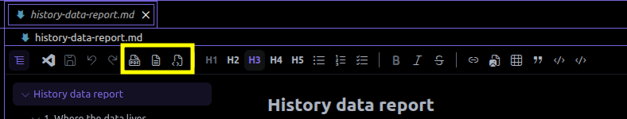

# foss-office

<div style="text-align: center;">
    
</div>

## Introduction

This extension lets you preview and edit common office files directly in VS Code. The `foss-office.theme` setting makes every viewer light or dark: `auto` (the default) follows your current VS Code color theme.

| Icon                                                                               | Feature      | Formats                                                                            | Mode                                               | Library behind it (version)                                                                                                                                                                                                                                                                                                                                                                                                                                                                                          | Technology                        |
| ---------------------------------------------------------------------------------- | ------------ | ---------------------------------------------------------------------------------- | -------------------------------------------------- | -------------------------------------------------------------------------------------------------------------------------------------------------------------------------------------------------------------------------------------------------------------------------------------------------------------------------------------------------------------------------------------------------------------------------------------------------------------------------------------------------------------------- | --------------------------------- |
|          | Markdown     | `.md`, `.markdown`                                                                 | Edit (WYSIWYG) and save; export to PDF, DOCX, HTML | [Vditor](https://github.com/Vanessa219/vditor) (modified copy in `vditor/`) with [Lute](https://github.com/88250/lute) and [CodeMirror](https://codemirror.net/) 6 for code blocks; exports: [markdown-it](https://github.com/markdown-it/markdown-it) 14.3.3, [Puppeteer](https://github.com/puppeteer/puppeteer) 25.16.0 (`puppeteer-core`, PDF), [vscode-html-to-docx](https://www.npmjs.com/package/vscode-html-to-docx) 1.1.3 (DOCX)                                                                            | TypeScript webview (no framework) |
|          | Document     | `.docx`, `.docm`, `.dotx`, `.dotm`                                                 | Edit and save                                      | [docx-editor](https://github.com/eigenpal/docx-editor) 1.9.0 (`@eigenpal/docx-editor-react`)                                                                                                                                                                                                                                                                                                                                                                                                                         | React webview, ProseMirror        |
|    | Spreadsheet  | `.xlsx`, `.xlsm`, `.xltx`, `.xltm`, `.xls`, `.xlt`, `.ods`, `.ots`, `.csv`, `.tsv` | Edit and save                                      | [x-spreadsheet](https://github.com/myliang/x-spreadsheet) (modified copy in `src/react/view/excel/x-spreadsheet`) for the grid; [ExcelJS](https://github.com/exceljs/exceljs) 5.0.3 ([@cweijan/exceljs](https://www.npmjs.com/package/@cweijan/exceljs) fork) for the xlsx family, macros kept; [SheetJS](https://github.com/SheetJS/sheetjs) 0.18.5 for `.xls`, `.xlt`, `.ods`, `.ots`; [uDSV](https://github.com/leeoniya/uDSV) 0.5.3 and [iconv-lite](https://github.com/ashtuchkin/iconv-lite) 0.6.3 for CSV/TSV | React webview, canvas grid        |
|            | Parquet      | `.parquet`                                                                         | Edit cells and save                                | [hyparquet](https://github.com/hyparam/hyparquet) 1.32.0, [hyparquet-writer](https://github.com/hyparam/hyparquet-writer) 0.15.7                                                                                                                                                                                                                                                                                                                                                                                     | React webview, Ant Design table   |
|  | Presentation | `.pptx`, `.pptm`, `.ppsx`, `.potx`, `.ppsm`, `.potm`                               | Read-only                                          | [pptxviewjs](https://www.npmjs.com/package/pptxviewjs) 1.1.9                                                                                                                                                                                                                                                                                                                                                                                                                                                         | React webview, canvas             |
|                    | PDF          | `.pdf`                                                                             | Read-only                                          | [PDF.js](https://github.com/mozilla/pdf.js) 3.1.81 (copy in `resource/pdf`)                                                                                                                                                                                                                                                                                                                                                                                                                                          | Plain JavaScript webview, canvas  |
|                | eBook        | `.epub`                                                                            | Read-only                                          | [epub.js](https://github.com/futurepress/epub.js) 0.3.93                                                                                                                                                                                                                                                                                                                                                                                                                                                             | React webview, iframe             |
|                | xMind        | `.xmind`                                                                           | Edit and save                                      | [Mind Elixir](https://github.com/SSShooter/mind-elixir-core) 5.15.1, [@mind-elixir/import-xmind](https://www.npmjs.com/package/@mind-elixir/import-xmind) 1.0.8 to read, [JSZip](https://github.com/Stuk/jszip) 3.10.2 to write                                                                                                                                                                                                                                                                                      | React webview, HTML and SVG       |

Notes:

- A read-only file (permissions, read-only file system) opens read-only in every viewer.
- While a file opens, every viewer shows the same loading spinner with the file's kind and name ("Loading spreadsheet data.csv..."), and the VS Code status bar shows the same message until the file is displayed.
- The interface follows the VS Code display language: English, Chinese, French, German, Japanese, Portuguese, Russian and Spanish. Other languages show English. The translations live in [`i18n/`](i18n/); see [Translations](#translations).
- [Keyboard shortcuts](#keyboard-shortcuts) lists the keyboard shortcuts of every viewer.
- The versions are those installed when this table was written; `package.json` has the exact ranges.
- The webviews are built with [React](https://react.dev/) 19 and [Ant Design](https://ant.design/) 5, except the PDF viewer and the Markdown editor.
- In the web extension (vscode.dev), Markdown export is not available.

## Quick start

This extension replaces the default Markdown editor with a WYSIWYG editor.

The links, the toolbar, the menus, the tables, the outline sidebar and the HTML editor take the accent color of your VS Code theme.

The editor's keyboard shortcuts are listed in [Keyboard shortcuts](#keyboard-shortcuts).

### Using VS Code's Markdown editor instead

To open Markdown files in VS Code's built-in text editor instead, add this to your `settings.json`:

```json
{
    "workbench.editorAssociations": {
        "*.md": "default",
        "*.markdown": "default"
    }
}
```

### Markdown export dependencies

In the toolbar, choose the button to export Markdown to PDF, DOCX, or HTML. PDF export requires Chromium, and DOCX export uses it to keep math and diagrams as images; set the browser path with `foss-office.markdown.export.chromiumPath`.



## Settings

All settings are under `foss-office.` in VS Code's Settings editor (search for "foss-office"). This list is generated from `package.json`, which has their full descriptions.

| Icon                                                                       | Component   | Setting                                               | Default                             | Values                                                                                                                          | Description                                                                                                                                                                                                                                                                                                                                                                                                                           |
| -------------------------------------------------------------------------- | ----------- | ----------------------------------------------------- | ----------------------------------- | ------------------------------------------------------------------------------------------------------------------------------- | ------------------------------------------------------------------------------------------------------------------------------------------------------------------------------------------------------------------------------------------------------------------------------------------------------------------------------------------------------------------------------------------------------------------------------------- |
|                                                                            | All viewers | `foss-office.theme`                                 | `"auto"`                            | `auto`, `light`, `dark`                                                                                                         | Theme of every viewer and editor of the extension. The eBook pages follow `foss-office.epub.theme`, the Markdown pages `foss-office.markdown.theme`, the document pages `foss-office.document.theme` and the PDF pages `foss-office.pdf.theme`.                                                                                                                                                                               |
|  | Markdown    | `foss-office.markdown.theme`                        | `"auto"`                            | `auto`, `light`, `dark`                                                                                                         | Colours of the Markdown editor's page (text, background, code blocks and diagrams); the toolbar, outline and menus follow `foss-office.theme`.                                                                                                                                                                                                                                                                                      |
|  | Markdown    | `foss-office.markdown.exportHtml.theme`             | `"auto"`                            | `auto`, `light`, `dark`                                                                                                         | Colours of the HTML export of a Markdown file. `auto` follows `foss-office.markdown.theme`. PDF and Word exports are always light.                                                                                                                                                                                                                                                                                                  |
|  | Markdown    | `foss-office.markdown.codeMirrorTheme`              | `"auto"`                            | `auto`, `light`, `dark`                                                                                                         | Theme of the code blocks in the Markdown editor. `auto` follows the page, so `foss-office.markdown.theme`.                                                                                                                                                                                                                                                                                                                          |
|  | Markdown    | `foss-office.markdown.mermaidTheme`                 | `"auto"`                            | `auto`, `light`, `light-forest`, `light-ocean`, `light-sunset`, `dark`, `dark-dracula`                                          | Theme of the Mermaid diagrams in the Markdown editor. `auto` follows the page, so `foss-office.markdown.theme`.                                                                                                                                                                                                                                                                                                                     |
|  | Markdown    | `foss-office.markdown.waitForAllMermaidDiagrams`    | `false`                             | `true`, `false`                                                                                                                 | When a Markdown file opens, wait for all its Mermaid diagrams to be drawn: the file's loading screen stays until then. Off, the file shows at once and each diagram shows a spinner until it is drawn, with the number of diagrams left in the status bar.                                                                                                                                                                            |
|  | Markdown    | `foss-office.markdown.editMode`                     | `"wysiwyg"`                         | `wysiwyg`, `ir`                                                                                                                 | Edit mode of the Markdown editor, for every Markdown file: WYSIWYG or IR (instant rendering). Switching the mode in the editor (its toolbar button or Ctrl+Alt+Shift+E) changes this setting in the user settings, and changing it switches the Markdown editors already open.                                                                                                                                                        |
|  | Markdown    | `foss-office.markdown.sidebar`                      | `"auto"`                            | `auto`, `none`                                                                                                                  | Whether the Markdown editor's outline sidebar, on the left, opens with the file. Shown or hidden with the toolbar's Outline button meanwhile, it is not remembered.                                                                                                                                                                                                                                                                   |
|  | Markdown    | `foss-office.markdown.openSearchResults`            | `false`                             | `true`, `false`                                                                                                                 | Open a Markdown file clicked in VS Code's Search view in the Markdown editor at the match, highlighted by its find bar. VS Code gives the match only to a text editor, so every Markdown file then opens as text for a moment before the Markdown editor replaces it. Turning this on adds `"*.md": "default"` and `"*.markdown": "default"` to `workbench.editorAssociations` in the user settings, and turning it off removes them. |
|  | Markdown    | `foss-office.markdown.useObsidianTags`              | `false`                             | `true`, `false`                                                                                                                 | Treat `#word` as an Obsidian tag in the Markdown editor: shown as a tag, and a double-click or Ctrl+click searches the workspace for it. When off, `#word` is plain text, and at the start of a line it is written as a heading `# word` (markdownlint MD018). Applies to Markdown files opened afterwards.                                                                                                                           |
|  | Markdown    | `foss-office.markdown.workspacePathAsImageBasePath` | `false`                             | `true`, `false`                                                                                                                 | Using workspace path as markdown image base path.                                                                                                                                                                                                                                                                                                                                                                                     |
|  | Markdown    | `foss-office.markdown.pasteImageToWorkspacePath`    | `false`                             | `true`, `false`                                                                                                                 | Paste markdown images into the workspace path and insert image links with a leading slash.                                                                                                                                                                                                                                                                                                                                            |
|  | Markdown    | `foss-office.markdown.pasterImgPath`                | `"image/${fileName}/${now}.${ext}"` | –                                                                                                                               | Markdown paste image path, variables: workspaceDir, fileName, now, date (YYYYMMDD), uuid, ext (file extension).                                                                                                                                                                                                                                                                                                                       |
|  | Markdown    | `foss-office.markdown.uiFontSize`                   | `13`                                | 10–24                                                                                                                           | Font size of the Markdown editor's toolbar, menus and panels, in pixels.                                                                                                                                                                                                                                                                                                                                                              |
|  | Markdown    | `foss-office.markdown.editorFontSize`               | `13`                                | 10–24                                                                                                                           | Font size of the document text in the Markdown editor, in pixels. Ctrl/Cmd+wheel in the editor changes it.                                                                                                                                                                                                                                                                                                                            |
|  | Markdown    | `foss-office.markdown.editorFontFamily`             | `"default"`                         | `default`, `humanist`, `serif`, `old-style`, `garamond`, `charter`, `slab-serif`, `narrow`, `mono`, `jetbrains-mono`, `courier` | Font of the document text in the Markdown editor.                                                                                                                                                                                                                                                                                                                                                                                     |
|  | Markdown    | `foss-office.markdown.boldColor`                    | `"default"`                         | `default`, `plain`, `accent`, `red`, `orange`, `purple`, `teal`                                                                 | Colour of bold text in the Markdown editor.                                                                                                                                                                                                                                                                                                                                                                                           |
|  | Markdown    | `foss-office.markdown.pageWidth`                    | `"full"`                            | `full`, `a4`, `a5`, `b5`, `letter`, `768px`, `960px`                                                                            | Maximum width of the document in the Markdown editor.                                                                                                                                                                                                                                                                                                                                                                                 |
|  | Markdown    | `foss-office.markdown.editorLineHeight`             | `1.7`                               | 1–3                                                                                                                             | Line spacing of the document text in the Markdown editor.                                                                                                                                                                                                                                                                                                                                                                             |
|  | Markdown    | `foss-office.markdown.codeFontFamily`               | `"default"`                         | `default`, `cascadia-code`, `consolas`, `monaco`, `andale-mono`, `courier-new`, `jetbrains-mono`, `fira-code`                   | Font of the code blocks in the Markdown editor. JetBrains Mono and Fira Code need to be installed.                                                                                                                                                                                                                                                                                                                                    |
|  | Markdown    | `foss-office.markdown.codeBlockMaxHeight`           | `"none"`                            | `none`, `300px`, `400px`, `600px`, `800px`                                                                                      | Maximum height of a code block in the Markdown editor before it scrolls.                                                                                                                                                                                                                                                                                                                                                              |
|  | Markdown    | `foss-office.markdown.imageMaxWidth`                | `100`                               | 10–100                                                                                                                          | Maximum width of images in the Markdown editor, in % of the page width.                                                                                                                                                                                                                                                                                                                                                               |
|  | Markdown    | `foss-office.markdown.imageMaxHeight`               | `70`                                | 10–100                                                                                                                          | Maximum height of images in the Markdown editor, in % of the window height.                                                                                                                                                                                                                                                                                                                                                           |
|  | Markdown    | `foss-office.markdown.export.chromiumPath`          | –                                   | –                                                                                                                               | Path of the Chromium-based browser (Chromium, Chrome, Edge, Brave...) the PDF and DOCX exports use. When empty, the usual install locations are searched; a path that does not exist is reported, not replaced.                                                                                                                                                                                                                       |
|  | Markdown    | `foss-office.markdown.puppeteerArgs`                | `[]`                                | –                                                                                                                               | Additional arguments to pass to Puppeteer/Chromium when exporting PDF. Example: ["--no-sandbox", "--disable-setuid-sandbox"] for Linux servers running as root.                                                                                                                                                                                                                                                                       |
|  | Markdown    | `foss-office.markdown.pdfMarginTop`                 | `25`                                | –                                                                                                                               | Printed pdf default top margin.                                                                                                                                                                                                                                                                                                                                                                                                       |
|  | Document    | `foss-office.document.theme`                        | `"auto"`                            | `auto`, `light`, `dark`                                                                                                         | Colours of the document editor's pages (Word files); the toolbar and menus follow `foss-office.theme`. Only the display changes: the document's colours are kept as they are, for saving and printing. The toolbar's light/dark button changes this setting in the user settings; a workspace value overrides it.                                                                                                                   |
|            | PDF         | `foss-office.pdf.theme`                             | `"auto"`                            | `auto`, `light`, `dark`                                                                                                         | Colours of the PDF viewer's pages; the toolbar and the sidebar follow `foss-office.theme`. The viewer's dark mode button (Ctrl/Cmd+L) changes this setting in the user settings; a workspace value overrides it.                                                                                                                                                                                                                    |
|            | PDF         | `foss-office.pdf.sidebar`                           | `"auto-outlines"`                   | `auto-outlines`, `always-outlines`, `always-thumbnails`, `none-outlines`, `none-thumbnails`                                     | Whether the PDF viewer's sidebar is open when a PDF opens, and the view (outline or thumbnails) it shows each time it opens. The outline view is empty for a PDF without an outline.                                                                                                                                                                                                                                                  |
|            | PDF         | `foss-office.pdf.tool`                              | `"hand"`                            | `hand`, `selection`                                                                                                             | The cursor tool the PDF viewer starts with when a PDF opens. The toolbar's tool buttons switch it for the open PDF only.                                                                                                                                                                                                                                                                                                              |
|            | PDF         | `foss-office.pdf.scrolling`                         | `"vertical"`                        | `vertical`, `horizontal`, `wrapped`                                                                                             | How the PDF viewer lays out the pages to scroll through when a PDF opens. The viewer's scrolling choices change it for the open PDF only.                                                                                                                                                                                                                                                                                             |
|            | PDF         | `foss-office.pdf.spread`                            | `"none"`                            | `none`, `odd`, `even`                                                                                                           | Whether the PDF viewer joins the pages in pairs (spreads) when a PDF opens. The viewer's spread choices change it for the open PDF only.                                                                                                                                                                                                                                                                                              |
|            | PDF         | `foss-office.pdf.zoom`                              | `"page-width"`                      | `page-width`, `page-fit`                                                                                                        | The zoom the PDF viewer opens a PDF with, and the one Ctrl/Cmd+0 goes back to. The toolbar's zoom changes it for the open PDF only.                                                                                                                                                                                                                                                                                                   |
|        | eBook       | `foss-office.epub.theme`                            | `"auto"`                            | `auto`, `light`, `dark`                                                                                                         | Colours of the eBook reader's pages; the menus follow `foss-office.theme`. The reader's "Themes" choice changes this setting in the user settings; a workspace value overrides it.                                                                                                                                                                                                                                                  |
|        | eBook       | `foss-office.epub.font.family`                      | `"System"`                          | `System`, `Arial`, `Lato`, `Georgia`, `Times New Roman`, `Arbutus Slab`                                                         | Font of the eBook reader's text. The reader's "Font" choice changes this setting in the user settings; a workspace value overrides it.                                                                                                                                                                                                                                                                                                |
|        | eBook       | `foss-office.epub.font.size`                        | `13`                                | `11`, `12`, `13`, `14`, `15`, `16`                                                                                              | Size of the eBook reader's text, in points. The reader's "Font Size" choice changes this setting in the user settings; a workspace value overrides it.                                                                                                                                                                                                                                                                                |
|        | eBook       | `foss-office.epub.line-height`                      | `1.6`                               | `1`, `1.2`, `1.4`, `1.6`, `1.8`, `2`, `2.3`, `2.6`, `3`                                                                         | Line spacing of the eBook reader's text, as a multiple of the font size. The reader's "Line Spacing" choice changes this setting in the user settings; a workspace value overrides it.                                                                                                                                                                                                                                                |

## Keyboard shortcuts

`Ctrl` is `Cmd` on macOS and `Alt` is `Option`, unless a macOS key is given. The viewers' shortcuts are built in and can't be rebound; only the two VS Code keybindings of the Markdown text editor can, in VS Code's Keyboard Shortcuts editor.

| Icon                                                                                                                                                                                                                                                                                                                                                                                 | Component                                       | Shortcut                                                      | Action                                                                                                                                                                   |
| ------------------------------------------------------------------------------------------------------------------------------------------------------------------------------------------------------------------------------------------------------------------------------------------------------------------------------------------------------------------------------------ | ----------------------------------------------- | ------------------------------------------------------------- | ------------------------------------------------------------------------------------------------------------------------------------------------------------------------ |
|                                                                                                                                                                                                                                                                                                                                                                                      | All viewers                                     | `Ctrl+V`                                                      | Default key action blocked (works around a double paste with Hebrew keyboards); pasting still works                                                                      |
|                                                                                                                                                                                                                                                                                                                                                                                      | All viewers (mac only)                          | `Ctrl+W`, `Ctrl+Alt+any key`                                  | macOS: the browser's own action for`Cmd/Ctrl+W` and `Cmd/Ctrl+Option+any key` is cancelled, so the VS Code shortcut runs once instead of twice                           |
|                                                                                                                                                                                                                                                                                                                                                                                      | All viewers                                     | `F12`                                                         | Open the webview developer tools                                                                                                                                         |
|                                                                                                                                                                                                                                  | Markdown, Document                              | `Ctrl+Alt+1` … `5` (`6` in markdown)                          | Heading H1 to H5, H6 in markdown (in markdown, H1 is refused if the file already has one above)                                                                          |
|                                                                                                                                                  | Markdown, Document, Spreadsheet                 | `Ctrl+B`                                                      | Bold                                                                                                                                                                     |
|                                                                              | Markdown, Document, Spreadsheet, xMind          | `Ctrl+Z` / `Ctrl+Y`                                           | Undo / redo                                                                                                                                                              |
|                                                                                                                                                  | Markdown, Document, Spreadsheet                 | `Ctrl+I`                                                      | Italic                                                                                                                                                                   |
|                                                                                                                                                  | Markdown, Document, Spreadsheet                 | `Ctrl+H`                                                      | Replace                                                                                                                                                                  |
|              | Markdown, Document, Spreadsheet, PDF, eBook     | `Ctrl+F`                                                      | Find                                                                                                                                                                     |
|                                                                                                                                                                                                                                  | Markdown, Document                              | `Ctrl+K`                                                      | Insert or edit a hyperlink                                                                                                                                               |
|      | Markdown, Document, Spreadsheet, Parquet, xMind | `Ctrl+S`                                                      | Save                                                                                                                                                                     |
|                                                                                                                                                  | Markdown, Document, Spreadsheet                 | `Ctrl+Shift+V`                                                | Paste as plain text                                                                                                                                                      |
|                                                                                                                                                                                                                                  | Markdown, Document                              | `Shift+Enter`                                                 | Line break                                                                                                                                                               |
|                                                                                                                                                                                                                            | Document, Spreadsheet                           | `Ctrl+B` / `Ctrl+I` / `Ctrl+U`                                | Bold / italic / underline                                                                                                                                                |
|                                                                                    | Document, Spreadsheet, eBook, xMind             | `Ctrl+C` / `Ctrl+X` / `Ctrl+V`                                | Copy / cut (if not read-only) / paste (if not read-only)                                                                                                                 |
|                                                                                | Spreadsheet, Presentation, PDF, xMind           | `Ctrl+mouse wheel`                                            | Zoom (`Shift`+wheel scrolls sideways for xMind)(the wheel alone pans when zoomed in, otherwise changes slide for Presentation)                                           |
|                                                                                                                                                                                                                                  | Spreadsheet, xMind                              | `F2`                                                          | Edit the cell/topic keeping its content                                                                                                                                  |
|                                                                                                                                                                                                                                                                                                            | Markdown (VS Code text editor)                  | `Ctrl+V`                                                      | Desktop: paste a clipboard image as a file and insert a link to it (a VS Code keybinding, can be rebound)                                                                |
|                                                                                                                                                                                                                                                                                                            | Markdown (VS Code text editor)                  | `Ctrl+Alt+E` (macOS `Ctrl+Cmd+E`)                             | Open the Markdown editor (a VS Code keybinding, can be rebound)                                                                                                          |
|                                                                                                                                                                                                                                                                                                            | Markdown                                        | `Ctrl+Alt+E` (macOS `Ctrl+Cmd+E`)                             | Edit in the VS Code text editor                                                                                                                                          |
|                                                                                                                                                                                                                                                                                                            | Markdown                                        | `(` and `[`                                                   | Add the closing ) or ] automatically                                                                                                                                     |
|                                                                                                                                                                                                                                                                                                            | Markdown                                        | `Alt+Enter`                                                   | On a link, image, HTML or table cell: open its popover. On a code block: open the language picker. In a top-level blockquote (WYSIWYG): insert a paragraph after it      |
|                                                                                                                                                                                                                                                                                                            | Markdown                                        | `Alt+Enter` / `Escape` / `Tab`                                | HTML and front-matter editors: save / cancel / insert a tab                                                                                                              |
|                                                                                                                                                                                                                                                                                                            | Markdown                                        | `Alt+Up` / `Alt+Down`                                         | Move the block up / down                                                                                                                                                 |
|                                                                                                                                                                                                                                                                                                            | Markdown                                        | `Arrow keys`                                                  | Move into or out of code blocks, inline math, tables and blockquotes; next to such a block, create a paragraph before or after it                                        |
|                                                                                                                                                                                                                                                                                                            | Markdown                                        | `Backspace` / `Delete`                                        | Context edits: unwrap a blockquote, remove a heading, empty list item, task box, horizontal rule, table of contents or empty code block                                  |
|                                                                                                                                                                                                                                                                                                            | Markdown                                        | `Ctrl+;`                                                      | Blockquote on / off                                                                                                                                                      |
|                                                                                                                                                                                                                                                                                                            | Markdown                                        | `Ctrl+M`                                                      | Table                                                                                                                                                                    |
|                                                                                                                                                                                                                                                                                                            | Markdown                                        | `Ctrl+Shift+J`                                                | Tick / untick the task                                                                                                                                                   |
|                                                                                                                                                                                                                                                                                                            | Markdown                                        | `Ctrl+Shift+L`                                                | In a table: align left                                                                                                                                                   |
|                                                                                                                                                                                                                                                                                                            | Markdown                                        | `Ctrl+Shift+R`                                                | In a table: align right                                                                                                                                                  |
|                                                                                                                                                                                                                                                                                                            | Markdown                                        | Standard CodeMirror keys                                      | In code, math, HTML and front-matter editors:`Ctrl+/` comment, `Ctrl+D` select next match, `Alt+Up/Down` move line, `Ctrl+]` / `[` indent, `Ctrl+Space` completion, etc. |
|                                                                                                                                                                                                                                                                                                            | Markdown                                        | `Ctrl+Shift+E`                                                | In a table: align center                                                                                                                                                 |
|                                                                                                                                                                                                                                                                                                            | Markdown                                        | `Ctrl+Alt+Shift+E`                                            | Toggle WYSIWYG / IR (instant rendering) mode                                                                                                                             |
|                                                                                                                                                                                                                                                                                                            | Document                                        | `Ctrl+A`                                                      | Select all                                                                                                                                                               |
|                                                                                                                                                                                                                                                                                                            | Document                                        | `Ctrl+L` / `E` / `R` / `J`                                    | Align left / center / right / justify                                                                                                                                    |
|                                                                                                                                                                                                                                                                                                            | Document                                        | `Tab` / `Shift+Tab`                                           | In a list: indent / outdent                                                                                                                                              |
|                                                                                                                                                                                                                                                                                                      | Spreadsheet                                     | `Ctrl+Alt+V`                                                  | Paste formatting only                                                                                                                                                    |
|                                                                                                                                                                                                                                                                                                      | Spreadsheet                                     | `Alt+any other key`                                           | Blocked while editing (Alt special characters can't be typed)                                                                                                            |
|                                                                                                                                                                                                                                                                                                      | Spreadsheet                                     | `Alt+Enter`                                                   | Line break inside the cell                                                                                                                                               |
|                                                                                                                                                                                                                                                                                                      | Spreadsheet                                     | `Arrow keys` / `Shift+Arrow keys`                             | Move the active cell / extend the selection                                                                                                                              |
|                                                                                                                                                                                                                                                                                                      | Spreadsheet                                     | `A`–`Z`, `0`–`9`, `=`                                         | Start editing and replace the content (`=` starts a formula)                                                                                                             |
|                                                                                                                                                                                                                                                                                                      | Spreadsheet                                     | `Backspace` / `Delete`                                        | Clear the selected cells                                                                                                                                                 |
|                                                                                                                                                                                                                                                                                                      | Spreadsheet                                     | `Ctrl+A`                                                      | Select all (the surrounding block first, then the whole sheet)                                                                                                           |
|                                                                                                                                                                                                                                                                                                      | Spreadsheet                                     | `Ctrl+Alt+0`                                                  | Auto-fit column widths                                                                                                                                                   |
|                                                                                                                                                                                                                                                                                                      | Spreadsheet                                     | `Tab` / `Shift+Tab`                                           | Commit the edit and move right / left                                                                                                                                    |
|                                                                                                                                                                                                                                                                                                    | Presentation                                    | `Left` / `Up` / `PageUp`                                      | Previous slide                                                                                                                                                           |
|                                                                                                                                                                                                                                                                                                    | Presentation                                    | `Right` / `Down` / `PageDown`                                 | Next slide                                                                                                                                                               |
|                                                                                                                                                                                                                                                                                                                      | PDF                                             | `Ctrl+L`                                                      | Dark / light pages                                                                                                                                                       |
|                                                                                                                                                                                                                                                                                                                      | PDF                                             | `Down`, `PageDown`, `Right`                                   | Next page (Down and Right only when the page fits the view)                                                                                                              |
|                                                                                                                                                                                                                                                                                                                      | PDF                                             | `F4`                                                          | Show / hide the sidebar                                                                                                                                                  |
|                                                                                                                                                                                                                                                                                                                      | PDF                                             | `Home` / `End`                                                | First / last page                                                                                                                                                        |
|                                                                                                                                                                                                                                                                                                                      | PDF                                             | `Space` / `Enter`, `Shift+Space` / `Shift+Enter`, `Backspace` | Next / previous page (page-fit or presentation mode)                                                                                                                     |
|                                                                                                                                                                                                                                                                                                                      | PDF                                             | `Up`, `PageUp`, `Left`                                        | Previous page (Up and Left only when the page fits the view)                                                                                                             |
|                                                                                                                                                                                                                                                                                                                      | PDF                                             | `Ctrl+S` / `Ctrl+H`                                           | Text selection tool / hand tool                                                                                                                                          |
|                                                                                                                                                                                                                                                                                                                  | eBook                                           | `Right` / `Left` (also `Down` / `Up` inside the book)         | Next / previous page                                                                                                                                                     |
|                                                                                                                                                                                                                                                                                                                  | xMind                                           | `Arrow keys`                                                  | Select the neighbouring topic                                                                                                                                            |
|                                                                                                                                                                                                                                                                                                                  | xMind                                           | `Ctrl+click`                                                  | Select several topics; on an expander, expand or collapse the whole branch                                                                                               |
|                                                                                                                                                                                                                                                                                                                  | xMind                                           | `Ctrl+Enter`                                                  | Add a parent topic                                                                                                                                                       |
|                                                                                                                                                                                                                                                                                                                  | xMind                                           | `Ctrl+K` then `0` / `=` / `1–9`                               | Collapse all / expand all / expand to level N                                                                                                                            |
|                                                                                                                                                                                                                                                                                                                  | xMind                                           | `Ctrl+Up` / `Ctrl+Left` / `Ctrl+Right`                        | Layout: both sides / left / right                                                                                                                                        |
|                                                                                                                                                                                                                                                                                                                  | xMind                                           | `F1`                                                          | Center the map                                                                                                                                                           |
|                                                                                                                                                                                                                                                                                                                  | xMind                                           | `Alt+Up` / `Alt+Down`                                         | Move the topic up / down                                                                                                                                                 |

Exceptions:

-  **Document**: the editor's built-in shortcut list (`Ctrl+/` or `F1` for help, `Ctrl+Shift+X` strikethrough, `Ctrl+0` zoom) isn't switched on in this extension.
-  **Spreadsheet**: grid keys need the last click to be inside the grid. While typing in a cell, `Ctrl+F`, `Ctrl+H` and `Ctrl+Alt+0` don't work (on macOS, `Cmd+F` and `Cmd+H` do).
-  **xMind**: maps are editable. Only when the file itself is read-only (opened from a git diff, on a file system that can't be written, or with read-only permissions) are the keyboard keys turned off; the map can still be moved by dragging or with the wheel, and zoomed with `Ctrl`+wheel.

## Development Guide

### Prerequisites

- [Node.js](https://nodejs.org/) 22.12+ (Vite 8 and `puppeteer-core` 25 need it)
- [VS Code](https://code.visualstudio.com/) 1.64+

### Getting started

```bash
git clone https://github.com/JayBeeDe/vscode-office.git
cd vscode-office
npm install
```

### Development

**Desktop extension** (full feature set):

```bash
npm run dev
```

Press `F5` in VS Code, or choose **Extension** from Run and Debug.

**Web extension** (office viewers and Markdown in the browser):

```bash
npm run dev:web
```

Choose **Extension (Web)** from Run and Debug.

### Build & package

```bash
npm run build    # production build
npm run package  # create .vsix
```

### Translations

Every user-visible string of the extension lives in [`i18n/`](i18n/), one JSON file per language.
The extension host and the webviews import these files through `src/i18n/index.ts`.

| Section       | Used by                                                                          | Placeholders filled by                                                                   |
| ------------- | -------------------------------------------------------------------------------- | ---------------------------------------------------------------------------------------- |
| `host`        | the extension host: notifications, dialogs, status bar                           | `i18n('markdown.exportFailed', { type, error })` in `src/common/global.ts`               |
| `viewer`      | the React viewers: document, presentation, eBook, xMind, Parquet                 | `$t('parquet.totalRows', { count })` in `src/react/i18n/i18nConfig.ts`                   |
| `document`    | the document editor's toolbar, menus and dialogs (`@eigenpal/docx-editor-react`) | the editor, `{name}` and ICU plurals: `{count, plural, one {# reply} other {# replies}}` |
| `spreadsheet` | the spreadsheet editor                                                           | `t('findReplace.replacedCount', { count })` in `src/react/view/excel/excel_i18n.ts`      |
| `markdown`    | the markdown editor (Vditor) and its context menu                                | sent by the host; the Vditor scripts in `vditor/src/js/i18n` are generated at build      |
| `pdf`         | the PDF viewer: the extension's buttons and PDF.js's interface                   | injected by the host (`src/provider/pdfViewerStrings.ts`)                                |

#### Rules

- `i18n/en.json` is complete and is the fallback: another language holds only what is translated,
  and a missing key shows the English text.
- The code holds no English text of its own: no `|| "Copy"` after a key, since `en.json` always
  fills in a missing translation. A key the code uses must exist in `en.json`.
- A language leaves out a key whose text is the same everywhere: keyboard shortcuts
  (`Ctrl+S`), example URLs, number formats (`1, 2, 3, ...`), product names. English is shown,
  which is right for them.
- Text written into the user's files stays in English: a new sheet is named after
  `spreadsheet.bottombar.defaultSheetName`, but sheets written without a name are `Sheet1`,
  `Sheet2`..., as Excel does, since formulas refer to them.
- Placeholders are named, `{count}`, never positional, and a translation uses the same ones
  as English.
- Lists (the spreadsheet's month and weekday names) keep the same length as in English.
- `pdf` groups PDF.js's strings by their ids, and the extension turns the tree back into them:
  - the path joined with `_` is the PDF.js id: `find.match.count` is `find_match_count`;
  - `@title`, `@label`, `@placeholder`, `@alt` are attributes of the element with that id
    (`data-l10n-id` in `resource/pdf/viewer.html`), and `@text` its text when the group also
    holds other strings; a plain string is the element's text;
  - a plural is a macro and one key per form, as in PDF.js: `find.match.count` has
    `"@text": "{[ plural(total) ]}"` and `[one]`, `[other]`... hold the texts; a language only
    needs the forms it uses.
- `document` mirrors the strings of `@eigenpal/docx-editor-i18n`: when upgrading the editor,
  compare its `en` locale with `document` in `en.json`, and take its new translations for the
  languages it ships (de, fr, pt-BR, zh-CN among ours; es, ja and ru are translated here). The check cannot tell which of these keys the editor uses.
- When upgrading PDF.js, compare its new `en-US/viewer.properties` with `pdf` in
  `en.json`: its `find_match_count[one]` is `find.match.count.[one]` here, and its `{{name}}`
  placeholders are written `{name}`.

#### Adding a language

1. Create `i18n/<language>.json`, named after the language code without region in lower case
   (`it`, `pl`...), with only the keys you translate. Every region uses it: `pt-BR` and
   `pt-PT` read `pt.json`, `zh-CN` and `zh-TW` read `zh.json`.
2. Import it in `LANGUAGES` in `src/i18n/index.ts`.
3. For the markdown editor's demo page only: add it to `VDITOR_LANGUAGES` in
   `vditor/vite.config.ts` when Vditor has a code for it.

#### Checks

`npm run i18n:check` (`-- --verbose` to list the warnings) checks the files, the keys and the
placeholders against English, the keys the code uses, and hard-coded strings in plain JS and
host code, then prints the coverage of each language. The build and CI run it; errors fail
them. ESLint (`npm run lint`) reports hard-coded strings in the React views.

A line with `i18n-ignore` is skipped by the hard-coded string scan; in the React views, use
`eslint-disable-next-line` with a reason.

The scans look for common patterns only (`title =`, `showErrorMessage('...')`, JSX text). They
miss text passed through a variable (`new Error('...')` shown later, `setError(message)`), the
`.ts` and `.js` files under `src/react` (the spreadsheet engine, the XMind parser), and
`vditor/src/ts`: review new text there by hand.

`package.json` (command titles, settings descriptions) is not translated: VS Code reads it
before the extension starts, so it would need `package.nls.<language>.json` files.

## Credits

The libraries behind each viewer are listed in the table in the [introduction](#introduction).

- Original extension: [cweijan/vscode-office](https://github.com/cweijan/vscode-office) by Weijan Chen (MIT)

- File icons for Parquet and eBook (`.parquet`, `.epub`): [PKief/vscode-material-icon-theme](https://github.com/PKief/vscode-material-icon-theme)
- File icons for spreadsheet, document, `.csv`/`.tsv`, `.pdf` and Markdown formats, and the presentation icon (adapted from the document icon): [jesseweed/seti-ui](https://github.com/jesseweed/seti-ui)
- Toolbar icons of the Markdown editor and of the spreadsheet, eBook and Parquet viewers: [Codicons](https://github.com/microsoft/vscode-codicons) (CC-BY-4.0)
- Toolbar icons of the document editor: [Material Symbols](https://github.com/google/material-design-icons) (Apache-2.0), as used by docx-editor
- Markdown diagrams, math and exports: [Mermaid](https://github.com/mermaid-js/mermaid) (MIT), [KaTeX](https://github.com/KaTeX/KaTeX) (MIT), [highlight.js](https://github.com/highlightjs/highlight.js) (BSD-3-Clause), [markdown-it-plantuml](https://github.com/gmunguia/markdown-it-plantuml) (MIT), [saveSvgAsPng](https://github.com/exupero/saveSvgAsPng) (MIT)
- Markdown editor undo history: [diff-match-patch](https://github.com/JackuB/diff-match-patch) (Apache-2.0)

## License

foss-office is free software, released under the [GNU General Public License v3.0 or later](LICENSE) (`GPL-3.0-or-later`).

It is a fork of [cweijan/vscode-office](https://github.com/cweijan/vscode-office), released under the MIT License. The code that comes from it keeps its original copyright notice, reproduced at the end of [LICENSE](LICENSE).
