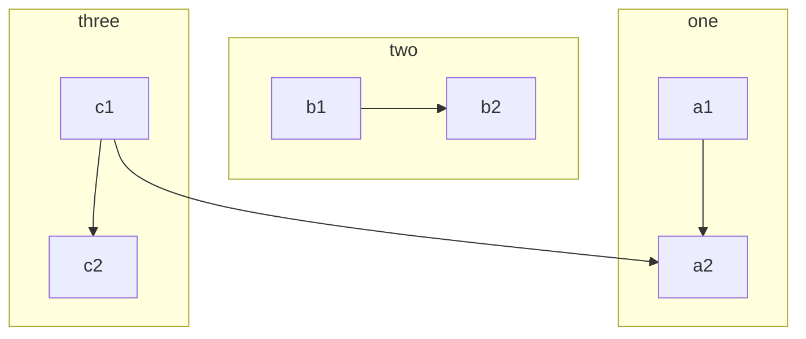
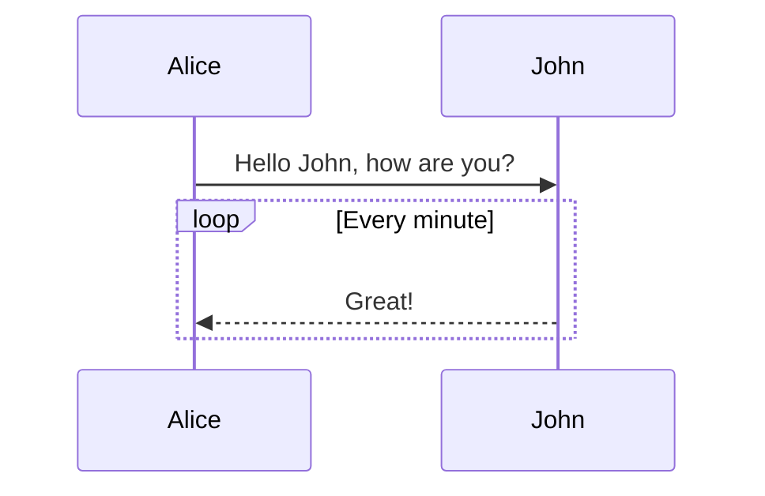
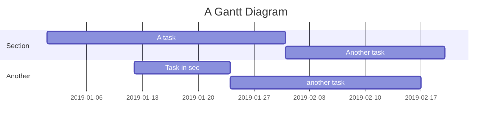

Vditor is a **WYSIWYG** editor that supports *Markdown*.

* If you don't know Markdown, use the toolbar or the shortcuts to format text
* If you know Markdown, just type it

For more details and usage, see [Vditor - a browser-based Markdown editor](https://ld246.com/article/1549638745630). Suggestions and bug reports are welcome, thank you ❤️

## Tutorial

This is a formatting sample that explains how to use **Markdown** well. It is worth learning: it makes your articles clearer.

> Quoted text: Markdown is a text formatting syntax inspired

## Syntax Guide

### Basic Formatting

This section shows some inline formatting, such as:

- **Bold** - `**Bold**`
- *Italic* - `*Italic*`
- ~~Strikethrough~~ - `~~Strikethrough~~`
- `Code mark` - `` `Code mark` ``
- [Hyperlink](https://ld246.com) - `[Hyperlink](https://ld246.com)`
- [username@gmail.com](mailto:username@gmail.com) - `[username@gmail.com](mailto:username@gmail.com)`

### Mentioning Users

@Vanessa Use `@User` to mention a user in the content; the mentioned user receives a notification.

> NOTE:
>
> 1. A space is required after @username
> 2. New users cannot mention others

### Large Heading - Heading 3

You can use H1 to H6, starting the line with ##(N). In posts and replies, use Heading 3 for top-level headings, not 1 or 2: 1 is the site level and 2 is the post title level.

> NOTE: don't forget the space after #!

#### Heading 4

##### Heading 5

###### Heading 6

### Images

```


```

Pasting an image uploads it directly.

### Code Blocks

#### Plain

```
*emphasize*    **strong**
_emphasize_    __strong__
var a = 1
```

#### Syntax Highlighting

Write a language name after ``` to get syntax highlighting, for example:

##### Go Highlighting Demo

```go
package main

import "fmt"

func main() {
	fmt.Println("Hello, World")
}
```

##### Java Highlighting Demo

```java
public class HelloWorld {

    public static void main(String[] args) {
        System.out.println("Hello World!");
    }

}
```

> Tip: supported language names include: `ruby`, `python`, `js`, `html`, `erb`, `css`, `coffee`, `bash`, `json`, `yml`, `xml` ...

### Ordered, Unordered and Task Lists

#### Unordered List

- Java
  - Spring
    - IoC
    - AOP
- Go
  - gofmt
  - Wide
- Node.js
  - Koa
  - Express

#### Ordered List

1. Node.js
   1. Express
   2. Koa
   3. Sails
2. Go
   1. gofmt
   2. Wide
3. Java
   1. Latke
   2. IDEA

#### Task List

- [X] Release Sym
- [X] Release Solo
- [ ] Book a dentist appointment

### Tables

Use a table to show data.

| header 1 | header 2 |
| -------- | -------- |
| cell 1   | cell 2   |
| cell 3   | cell 4   |
| cell 5   | cell 6   |

### Collapsible Details

<details>
<summary>This is the summary.</summary>
These are the details.
</details>

### Paragraphs

A blank line splits content into paragraphs, which makes it easier to read. (This is the first paragraph.)

Blank lines matter a lot in Markdown formatting. (This is the second paragraph.)

### Reference Links

[Link text][link-id]

[link-id]: https://b3log.org
```
[Link text][link-id]

[link-id]: https://b3log.org
```

### Math

Multi-line formula block:

$$
\frac{1}{
  \Bigl(\sqrt{\phi \sqrt{5}}-\phi\Bigr) e^{
  \frac25 \pi}} = 1+\frac{e^{-2\pi}} {1+\frac{e^{-4\pi}} {
    1+\frac{e^{-6\pi}}
    {1+\frac{e^{-8\pi}}{1+\cdots}}
  }
}
$$

Inline formula:

The formula $a^2 + b^2 = \color{red}c^2$ is inline.

### Flowchart



### Sequence Diagram



### Gantt Chart



### Media

Links to v.qq.com, youtube.com, youku.com, coub.com, facebook.com/video, dailymotion.com, .mp4, .m4v, .ogg, .ogv, .webm, .mp3 and .wav are embedded

https://v.qq.com/x/cover/zf2z0xpqcculhcz/y0016tj0qvh.html

### Footnotes

Here is a footnote reference[^1], and here is another one[^bignote].

[^1]: The first footnote definition.
    
[^bignote]: A footnote definition can have several paragraphs.
    
       Indented paragraphs are part of this footnote definition.
    
       ```
       Code blocks can be used.
       ```
       So can other inline formatting, such as **bold** and [links](https://b3log.org).
    
```
Here is a footnote reference[^1], and here is another one[^bignote].
[^1]: The first footnote definition.
[^bignote]: A footnote definition can have several paragraphs.

    Indented paragraphs are part of this footnote definition.

    ```
    Code blocks can be used.
    ```

    So can other inline formatting, such as **bold** and [links](https://b3log.org).
```

## Shortcuts

The editor supports many shortcuts, see [Keyboard shortcuts](https://ld246.com/article/1474030007391) (or press "`?` " 😼)
